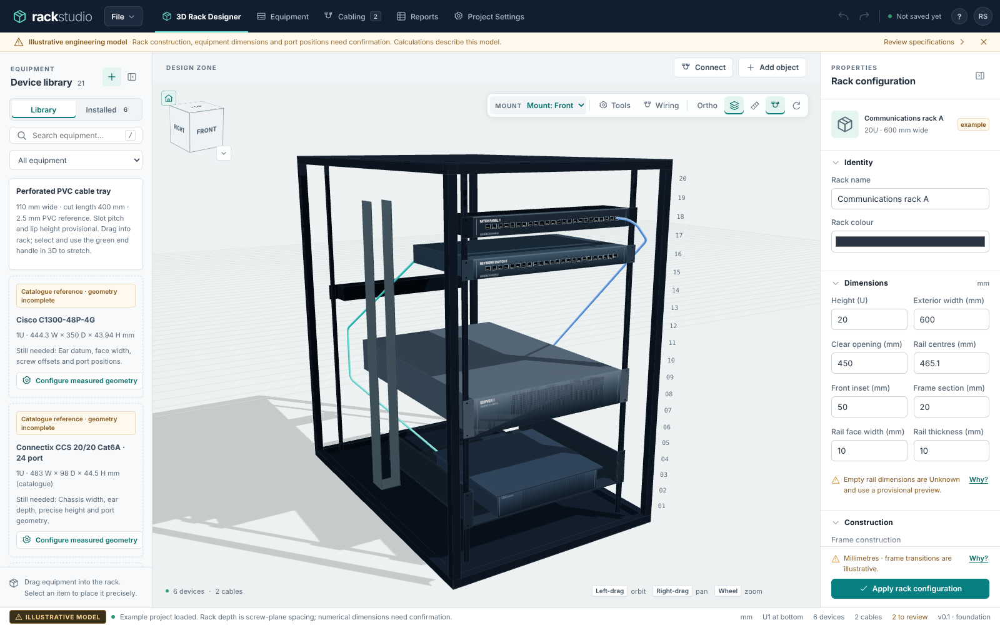

# User guide · foundation milestone

The opening project is an illustrative20U rack. Its numerical dimensions are examples. Rack depth means the distance between the front and rear screw planes; U1 starts at the bottom, and a new rack has no depth step. Square holes with cage nuts are the current default.

## Workspace layout

The workspace bar has five tabs: **3D Rack Designer**; **Equipment** (Device Library, Device Model Designer); **Cabling** (Cable Schedule, Connections; the badge counts physical cables); **Reports** (Cut List, Procurement, Power & Weights); and **Project Settings**. A tab with several views shows them in a second bar underneath and reopens the view you last used there. Below, "Equipment → Device Library" means the Equipment tab, then its Device Library view.

The amber **Illustrative engineering model** strip under the tabs states that dimensions and port positions need confirmation. Its × hides it for the current browser session only; the amber **Illustrative model** badge beside the project name stays visible and reopens it. A rack marked verified shows **Verify cables** instead, because cable specifications and routes still need verification.

In the 3D Rack Designer, the equipment library (left) and properties panel (right) collapse with the panel icon in their headings and reopen from the labelled rail. Drag a panel's inner edge, or focus it and use the arrow keys (Shift for larger steps), to resize it. Widths and open/closed state are remembered in this browser.

The properties panel groups fields into titled sections (for equipment: Identity, Position & mounting, Rails, Power & weight, Ports; for cables: Identity, Specification, Length breakdown, Route; for the rack: Identity, Dimensions, Construction, Mounting & depth, Structural members). Click a section heading to collapse or expand it; each section type remembers its state. Caveats appear as one-line notes, amber for provisional or unverified data, with **Why?** for the full explanation. Route issues, length warnings and placement errors are always shown above the sections. Equipment name, rack and position edits show **Unapplied** until you press **Apply position**.

Hover or keyboard-focus any icon button for its tooltip. The **?** button opens the quick guide.

## Configure and install

Select an installed rack chassis and enable **Fit sliding rack rails**. **Pull device forward on rails** selects the example service position, using the user-confirmed 500 mm rail projection and approximate 600 mm chassis protrusion. Member dimensions, mounting height and chassis lead are editable; post spacing has no invented kit min/max. Supplied cables keep their lengths and can become insufficient. See [sliding rail guide](device-rails.md).
Use the right panel to edit the rack. Screw-plane depth and illustrative exterior frame depth are separate fields. Apply changes as one transaction. To add a step, split a depth section and set its inclusive U boundaries and rear screw-plane position. The section validator rejects gaps or overlaps. Construction and transition supports still need real measurements.

Front screw-plane Z, front-to-rear spacing and rail profile width/thickness are independent of the exterior frame. Choose a generic provisional frame preview or explicit structural members. Add beams/crossmembers with your own positions, dimensions and profile; angle/channel sections require wall thickness and orientation. In the equipment library, parametric shelves have separate overall and usable dimensions plus explicit support components. See [configurable construction](configurable-construction.md), including the importable 20U/800–750 mm reference. Unfinished component drafts must be added or cancelled before saving.

For a rear-mounted device, click **Rear** above the viewport, then drag from the library onto the required U. Rear view now selects **Mount: Rear** for new drops; Front view selects **Mount: Front**. In 3D, side or top view, choose the visible **Mount: Front/Rear** selector explicitly. Changing the camera does not flip an already installed device when moving it. The precise placement dialog starts with the same selected face and also has its own **Mounting face** field.

Drag a device from the library onto a U location. The preview shows the snapped position and any error; invalid drops do not install. The plus icon on a card opens precise placement, including front/rear face and a supporting shelf for a freestanding computer. Select installed equipment to change its name or U position. Moving equipment retains its cable IDs and updates its port endpoints. Undo/redo are available from the toolbar and Ctrl+Z/Ctrl+Shift+Z.

Orbit with the left mouse button on empty workspace, pan with the right button, and zoom with the wheel; the viewport footer repeats these controls. Front/rear/left/right/top/3D buttons position the camera; Ortho changes projection. Labels, dimension guides and cables are independent icon toggles; a switched-on toggle shows a teal chip with an underline. **Mount** turns amber when new drops will mount on the rear face. An empty rack shows a drag-to-place hint naming the current mounting face. Selecting equipment can be done through the installed-equipment strip when a port or cable obscures it.

Catalogue cards for the requested Cisco/Connectix/APC models include published facts and unresolved fields. Configure measured geometry before saving them into the usable library. Zero in an incomplete draft is an unanswered field and blocks saving. Do not copy maximum overall width into a chassis-width field, or assume catalogue depth starts at the mounting ears. Generic examples can be used while the exact mechanical drawings are unavailable.

## Define ports and cables

The **Equipment → Device Model Designer** view provides isolated 3D preview and front/rear drag/drop authoring. See [the designer and tray guide](model-designer.md), including the perforated PVC tray's fixed-hole stretch behaviour and calibration limits.
**User rack PC · 1U** models the photographed computer. Its 431.8 mm chassis width, 482.6 mm ear width and 381 mm ear-to-rear depth are user measurements; 1U is confirmed and physical height 43 mm is provisional. Two front and fifteen rear sockets have editable photo-estimated centres. Use the equipment library in a new project, import `examples/user-rack-pc.library.json` into an existing project's expanded library, or open `examples/user-rack-pc.rack.json`. See [PC reference notes](user-pc-reference.md) for the port inventory and outstanding measurements. Chassis edits do not automatically rescale stored ports or fittings.

Edit a library definition, open Ports and enter each port's identity, connector, local coordinates and outward direction. Images are embedded in the project and can be fitted to front/rear faces; calibration, cropping and perspective correction are not implemented. An image is not a dimension source by itself.

Each port can have its own evidence, source notes and schematic socket dimensions. A connected port with explicit unverified evidence keeps the cable's model result unverified, even if the enclosing device has been marked verified. Legacy ports without separate evidence inherit the device's status. The upper rear video connector on the photographed PC remains unconfirmed; it is not assumed compatible with DisplayPort.

Connect chooses two defined ports and validates compatibility and occupied single-use ports. Cable properties contain a mutable number, name, purpose, supply type, geometry and length settings. Numbering starts at0. The schedule's Renumber0… operation updates labels while preserving internal identities and connections.

Choose Follow an existing cable run to reuse a section of another route. Set the join and breakout percentages and, if needed, a parallel centreline offset. The target cable retains its own endpoints and is validated independently. Red routes require correction; moving a source device recalculates the related geometry. No physical tie or fixing is implied by this relationship.

## External runs and lengths

For interactive rack cabling, open **Wiring** in the 3D viewport. Its panel docks at the left of the viewport (hide it with its panel icon; the mode stays active), and a dark pill under the toolbar states the active tool and what the next click does, for example "Wiring · Connect ports — click the source port". **Esc** cancels a pending click; with nothing pending, **Esc** or the pill's **Exit** leaves the mode. **Tools** works the same way. **Connect ports** uses two socket clicks. **Waypoints** places guides 10 mm outward from clicked surfaces; Shift-click starts a line and a second click finishes it. Choose a cable, enter **Link cable**, and click guides in route order. Reverse/reorder/unlink in the route list, or edit shared guide coordinates. Guides stay fixed in world space when equipment moves. See [the Wiring mode guide](wiring-mode.md).

Create a rack exit in a clear opening, then a named logical destination from **Cabling → Connections**. Connect a rack port to that destination through the exit. Enter the surveyed external distance on the cable. Until entered, the total required length remains unknown even though the rack-side route has a calculated length.

Bulk cable uses endA60mm + endB60mm by default, with no default service loop. Both allowances and their120mm total appear in the schedule and are editable per cable. Rounding goes upwards. A preterminated cable retains its supplied assembly length and is checked against the requirement; it is never stretched. Available excess does not establish that slack physically fits.

## Reports and saving

The master schedule supports searching, sorting, supply filtering, column selection/reordering, purpose editing and multi-row installation-status changes. Select a row and return to3D to highlight that cable. CSV exports include all physical cable records. The cut list distinguishes bulk cuts from supplied assemblies; Procurement allocates continuous cuts, shows remnants and separates technical feasibility from reserve recommendations.

**Reports → Power & Weights** lists every placed device with its mass, nominal and maximum draw, maximum inlet current and the PDU or UPS bank outlet that feeds it. It then shows each distributor's bank loads and status, the totals (mass, draw, estimated heat, unconnected and dual-fed devices, and each distributor's input load) and the power issues. Enter draw and mass in **Inspector → Power & weight** for a selected device; for example, giving the PC a mass adds it to the total mass. Unknown values read `Unknown`, and a total starting with `≥` is incomplete. **Export CSV** downloads the document as a sectioned CSV, and **Print / save PDF** prints it or saves it as a PDF through the browser. See [power and weight](power-and-weight.md#power--weights-document).

Enter actual reel products and partial stock before relying on purchasing quantities. Provisional results allocate only known cuts. Inventory is not reserved or consumed across projects yet. Unknown dimensions, cable bend specifications or external surveys prevent an installation-grade conclusion.

Save writes this browser's IndexedDB; edits autosave after a short delay. Open lists locally saved projects. Export project creates a portable JSON backup with embedded images. Import validates the whole graph and rejects unknown fields rather than discarding them. Keep exported backups if moving browser/computer or clearing browser data.

The project remains under development. Consult [acceptance.md](acceptance.md) before treating any stage as complete.

## Modelling, cable hardware and equipment calibration

See [Modelling workspace](modelling-workspace.md) for free tray placement/rotation, guide dragging, duplicate/align, measurements, visibility, surface clips/ties, bundles, positioned vehicle endpoints and adjacent rack assemblies. Use **Equipment → Device Library → Edit** to calibrate existing photographed equipment; use **Equipment → Device Model Designer** for new chassis. Save and export both the library and project JSON. Libraries remain project-local.

## Generic network switch

Search **Generic 24-port switch · 1U** in the library. Existing projects offer **Add generic 24-port switch**. It has 24 front RJ45 in one row, two front SFP cages and a rear IEC C14 inlet. Place or drag it normally, edit its ports in the library, and save/export the project. See [switch guide](generic-switch.md) for provisional dimensions and the separate legacy switch.

## Lacing bar

An importable [front/rear example](../examples/lacing-bars.rack.json) and [standalone library definition](../examples/lacing-bars.library.json) are included.

Search **Adjustable lacing bar · middle hole** under **Cable management**. Existing projects without this definition show **Add lacing bar**. Drag it into a U or use the card's plus button to choose U and front/rear mounting precisely. Each end tab contacts its rail and uses the middle screw hole of that U. Two inward returns meet an open horizontal crossbar; there is no solid panel across the centre.

The default **150 mm clear inward reach** is measured from the ear bearing plane to the inside face of the crossbar. The illustrative 6 mm profile makes overall depth 156 mm. **Edit** the library card to change inward reach, bar profile, width or tab height. Geometry regenerates; its ears stay at the mounting plane. Definition edits affect every instance, so duplicate the library definition first when different reaches are required. The allocated 1U and middle-hole mounting pattern remain fixed. Profile and tab dimensions are provisional.

In **Wiring → Waypoints**, click the bar surface for a point, or Shift-click one end and click the other for a crossbar line guide. Surface guides have the existing 10 mm outward offset. Select a cable and use **Link cable** to include these guides. Ordinary surface guides stay in place when the bar moves; recheck them after repositioning. The steel returns/crossbar participate in collision checks, while the centre is open. No load rating or product-specific mounting kit is inferred.
